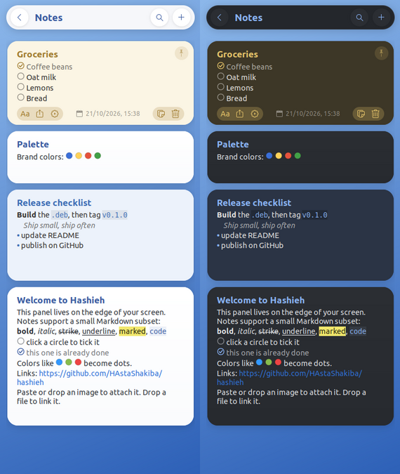

# Hashieh

*Hashieh* (حاشیه, "margin") is a **free, open-source SideNotes alternative for Windows, Linux and macOS**: a sticky-notes panel that lives on the edge of your screen. It
has folders, colored note cards, light Markdown, tasks, color swatches, pictures and file links.
It can import and export the notes and themes of
[SideNotes](https://www.apptorium.com/sidenotes) for macOS, so you can move your notes from a Mac.

Website: <https://hastashakiba.github.io/hashieh/>

> **Unofficial.** Hashieh is an independent project. It is not affiliated with or endorsed by
> Apptorium, the makers of SideNotes. It doesn't include any SideNotes code or assets.



## Install

Download the file for your system from [Releases](https://github.com/HAstaShakiba/hashieh/releases):

| System | File | Show / hide shortcut |
|---|---|---|
| Ubuntu / Debian | `hashieh_<version>_all.deb`, then `sudo apt install ./hashieh_*_all.deb` | Super+Ctrl+N |
| Windows 10/11 (x64) | `Hashieh-<version>-windows-x64-setup.exe` (or the portable `.zip`) | Ctrl+Alt+N |
| macOS 11+ (Apple Silicon) | `Hashieh-<version>-macos-arm64.dmg`, drag Hashieh to Applications | Cmd+Ctrl+N |

The first time you start Hashieh it turns on *Start at login* and binds the show/hide shortcut.
It only binds the key if nothing else uses it. You can change or turn off both in ⚙, and Hashieh
won't turn them back on.

The Windows and macOS builds aren't code-signed yet, so the first launch shows a warning:

* **Windows:** SmartScreen says "Windows protected your PC". Click *More info*, then *Run anyway*.
* **macOS:** if macOS says the app "can't be opened", open *System Settings ▸ Privacy & Security*
  and click *Open Anyway*. You can also run `xattr -dr com.apple.quarantine /Applications/Hashieh.app` once.

On Windows and macOS, global shortcuts work while Hashieh is running, and it starts at login.
On macOS Hashieh has no Dock icon; open it with the shortcut or the handle on the screen edge.

**From source** (needs `python3-gi`, `python3-gi-cairo` and `gir1.2-gtk-3.0`):

```bash
git clone https://github.com/HAstaShakiba/hashieh.git
cd hashieh
./install.sh
```

`install.sh` puts `hashieh` in `~/.local/bin` and adds a menu entry. Autostart and the shortcut
are set up on first start, as with the package. You can also choose them up front with
`--autostart` and `--shortcut '<keys>'`. To remove it, run `./install.sh --uninstall`.

## Use

Open the panel with your shortcut, or click the small handle on the screen edge. In the panel:

* Click a note to edit its text. It goes back to the rendered view when you click elsewhere.
* Click a circle to tick a task. Click a link to open it. Click a color dot to copy its value.
* Paste or drop an image to attach it. Drop any other file to link to it.
* Hover over a note to show its toolbar: formatting, sharing, color, moving, copying and deleting.
* Right-click a folder to rename, pin, color or delete it.
* Open **⚙** for theme, light/dark mode, screen side, *Start at login*, *Keyboard shortcuts…* and
  *Google sync*.

Notes support `# headings`, `**bold**`, `*italic*`, `~~strike~~`, `==underline==`,
`::marked::`, `` `code` ``, code blocks, `> quotes`, lists, `[ ]`/`[x]` tasks and `#rrggbb`
colors.

### Keyboard shortcuts

You can change all of these in ⚙ ▸ Keyboard shortcuts…

| Shortcut | Action |
|---|---|
| `Super+Ctrl+N` (global) | show / hide the panel (anywhere on the desktop) |
| `Ctrl+N` | new note (new folder in the folder list) |
| `Ctrl+F` | search |
| `Esc` | stop editing, go back, hide |
| `Ctrl+Delete` | delete the current note |
| `Ctrl+=` / `Ctrl+-` | bigger / smaller text |
| `Ctrl+W` / `Ctrl+Q` | hide / quit |

### Command line

```text
hashieh                              start (or show) the panel
hashieh --toggle | --show | --hide
hashieh --new-note "text"            add a note to the current folder
hashieh --new-note-from-clipboard
hashieh import PATH                  import SideNotes data (see below)
hashieh export DIR                   export data.json + images/
hashieh sync [login|logout|status]   sync with Google Drive (signs in first if needed)
hashieh themes install PATH          install .sntheme files (file, folder or SideNotes.app)
hashieh shortcut toggle '<Super><Control>n'
```

## Moving notes from SideNotes on a Mac

iCloud sync isn't available on Linux, so you move notes as files:

1. On the Mac, quit SideNotes and copy `SideNotes.sqlite` along with its `-wal`/`-shm` files and
   the `.SideNotes_SUPPORT` folder if there is one. Search `~/Library/Containers` and
   `~/Library/Group Containers` for it. A `.snbackup` file from the app's Backups settings also
   works.
2. On Linux, run `hashieh import /path/to/SideNotes.sqlite`, or use ⋯ ▸ Import SideNotes data.

Importing doesn't change the source file, and you can import again later: notes are matched by ID,
and the newer copy wins. To use your SideNotes themes too, run
`hashieh themes install /path/to/SideNotes.app`.

## Sync with Google

Open ⚙ ▸ Google sync ▸ *Sign in with Google…* and allow Hashieh in your browser. Do the same on
each computer. Hashieh then syncs when it starts, every 5 minutes, when you hide the panel, and when
you click *Sync now*.

* Notes, folders and pictures go to Hashieh's own hidden folder in your Google Drive. Hashieh can't
  see your other Drive files, and you won't see this folder in Drive. *Manage apps* in Drive's
  settings can delete it.
* The first sync merges what each computer has. After that, when the same note changed on two
  computers, the later change wins. A deleted note stays deleted unless it was edited later
  somewhere else.
* Keep your clocks right: changes are compared by time. A computer offline for more than 180 days
  may bring back notes deleted meanwhile.
* *Sign out* stops syncing on that computer. Your notes stay on it and in Drive.

## Platform notes

* **Linux:** global shortcuts are GNOME keyboard shortcuts, so they work even before Hashieh is
  running. Other desktops can bind their own shortcut to `hashieh --toggle`.
* **Windows / macOS:** the builds bundle GTK 3, so they don't look fully native, and they are
  ~30 MB. Command-line use: `hashieh-cli.exe` next to `Hashieh.exe` on Windows, and
  `/Applications/Hashieh.app/Contents/MacOS/Hashieh` on macOS.
* **Intel Macs** aren't built yet.

## Wayland

GTK 3 can't place windows on native Wayland. While the panel is docked, Hashieh runs through
XWayland so it can stay on the screen edge and on top of other windows. If you turn docking off
(⚙ ▸ Window ▸ Floating window), it runs as a normal native window.

## Files

| | Linux | Windows | macOS |
|---|---|---|---|
| Notes (`notes.db`), themes | `~/.local/share/hashieh` | `%LOCALAPPDATA%\Hashieh` | `~/Library/Application Support/Hashieh` |
| Settings (`config.json`), Google sign-in (`google-account.json`) | `~/.config/hashieh` | `%APPDATA%\Hashieh` | `~/Library/Application Support/Hashieh` |

Notes are a single SQLite file, with pictures stored inside it.

## Compatibility notes

The SideNotes data model, the JSON export layout, the text syntax and the `.sntheme` format were
worked out from the shipped macOS app for interoperability. Some details are educated guesses:

* `==text==` is treated as underline.
* *Standard* and *Markdown* note formatting are rendered the same way.
* File links created on a Mac may point to paths that don't exist on Linux.
* The internal layout of `.snbackup` files hasn't been confirmed.

Not implemented yet: reminders, locked notes, iCloud sync with SideNotes, and syntax
highlighting by language.

## Development

```bash
python3 -m unittest discover -s tests -t .   # tests (GNOME settings use an in-memory backend)
packaging/build.sh                           # dist/: .tar.gz, .deb and SHA256SUMS
```

Google sync needs an OAuth client. In the [Google Cloud console](https://console.cloud.google.com/),
enable the *Google Drive API*, set up the OAuth consent screen with the
`https://www.googleapis.com/auth/drive.appdata` scope, and create an OAuth client ID of type
*Desktop app*. Hashieh's own client is in `CLIENT_ID` and `CLIENT_SECRET` in `hashieh/sync.py`; to
use another one, change them there or set `HASHIEH_GOOGLE_CLIENT_ID` and
`HASHIEH_GOOGLE_CLIENT_SECRET` when running. Google treats a desktop client's secret as public.

CI runs the tests and builds the packages on Ubuntu 22.04 and 24.04 for every push and pull request.
The Windows and macOS builds (PyInstaller, `packaging/hashieh.spec`) run on their own runners,
which also run `hashieh selftest` on the built app and upload its screenshot and report.

To release, bump `__version__` in `hashieh/__init__.py`, optionally add
`packaging/release-notes/vX.Y.Z.md`, commit, and push a matching tag:

```bash
git tag v0.1.1 && git push origin v0.1.1
```

The Release workflow checks that the tag matches the version, runs the tests, builds the packages
and publishes a GitHub release with them. Without a notes file, GitHub generates the notes.

## License

MIT. See [LICENSE](LICENSE).
